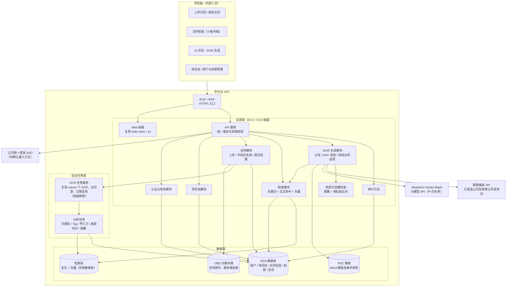
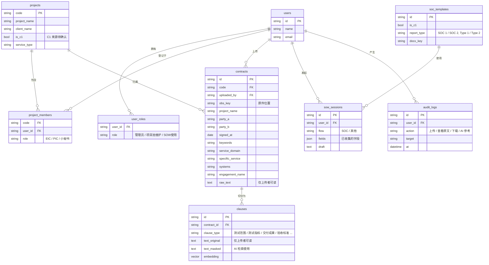
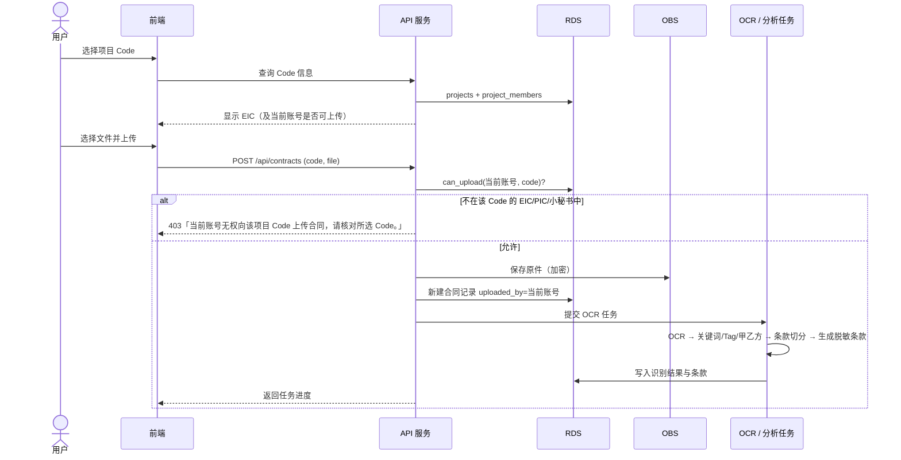
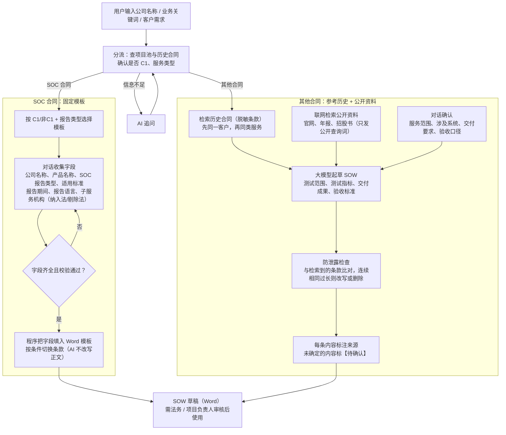
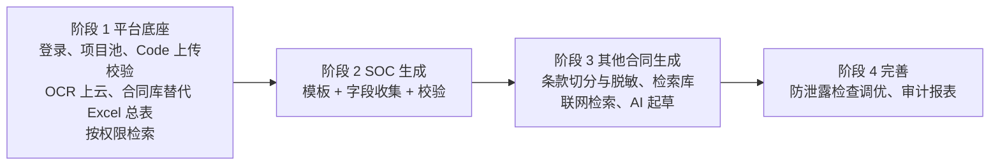

# 合同平台整体架构（华为云 Web 版）

> 本文档说明 contract-ocr 从「Windows 单机桌面工具」升级为「华为云上的多用户网页平台」的底层框架与已确定的设计决策。
> 图使用 Mermaid 绘制，GitHub 会直接渲染。新对话或新成员阅读本文即可了解全貌。
> 基线代码：`feature/merge-list-edit-uploader`（v2.15.0）。

---

## 1. 目标

| 能力 | 说明 |
|---|---|
| 项目池与上传权限 | 先选项目 Code，系统显示该 Code 的 EIC；只有该 Code 登记的 EIC / PIC / 小秘书可以上传 |
| 合同库与检索 | 上传后 OCR、识别关键词与标签；所有人可检索，原文只对上传者本人可见 |
| AI 对话式 SOW 生成 | SOC 合同：对话收齐字段后按固定模板生成；其他合同：参考历史合同 + 公开资料 + 对话确认的信息起草 |
| 角色权限 | 管理员 / 项目池维护人员 / SOW 使用人员（小秘书端） |
| 部署 | 华为云，内部人员通过浏览器使用 |

---

## 2. 总体架构



**原则**

1. 所有权限判断都在 **API 服务端** 完成；前端置灰按钮只是提示。
2. 返回其他人合同的接口一律经过 **字段白名单**，原文永远不会发到非上传者的浏览器。
3. AI 只读取 **脱敏后的条款**；生成结果经过 **相似度检查** 才返回。
4. 发往外网（联网搜索）的只有公开查询词，**绝不包含合同内容**。

---

## 3. 现有代码如何迁移

| 现有代码 | 平台化后 | 处理方式 |
|---|---|---|
| `index.html`、`css/`、`js/app.js`、`js/vault.js` 等前端 | Web 前端 | 复用；数据来源由本机服务改为平台 API |
| `js/extractor.js`、`js/keywords.js`、`js/service-content.js`、`js/contract-scope.js`、`js/audit-review.js` | 分析任务 | 复用规则；在服务端（Node）或浏览器运行，结果写入数据库 |
| `native/engine.py`、`native/documents.py`、`native/stamp_removal.py`、`native/date_review.py` 等 | OCR 任务服务 | 复用；改为从任务队列取文件 |
| `native/offline_guard.py` | OCR 任务服务 | 只保留在 OCR 进程上 |
| `native/desktop.py` 的本机 JSON 存储 | RDS + OBS | 重写为数据库访问 |
| `native/excel_table.py` 云盘 Excel 总表、合并逻辑 | 合同库 | 总表不再需要；`COLUMNS` 定义沿用为「他人合同可见字段白名单」；导出 Excel 功能保留 |
| `native/fulltext_index.py` 布隆过滤器加密索引 | 检索模块 | 不再需要；服务端直接判断全文是否包含搜索词，只返回命中的词 |
| 上传者 ID 取 Windows 账户名 | 登录账号 | 由认证模块提供 |

---

## 4. 角色与权限（已确定）

### 4.1 规则

| 规则 | 内容 |
|---|---|
| 上传 | 只有项目池中登记在该 Code 下、角色为 **EIC / PIC / 小秘书** 的账号可上传 |
| 查看原文 | **只有上传者本人**（查看全文、下载原件、定位到识别全文） |
| 他人合同 | 所有人只读查看基本信息，字段同小秘书端「合同检索」（见 6.2） |
| AI 参考 | 所有合同（脱敏版本）都可被 AI 检索参考，界面不显示他人原文 |
| 管理员 | 只管理用户、角色、Code 与人员关系、SOC 模板；**不能查看原文，也不因管理员身份获得上传权限** |

> 待确认：同一 Code 的 EIC / PIC / 小秘书之间是否可互相查看原文。当前按严格规则（仅上传者本人）实现；放宽只需修改 `can_view_original`。

### 4.2 角色权限矩阵

| 权限点 | 管理员 | 项目池维护人员 | SOW 使用人员（小秘书端） |
|---|---|---|---|
| 管理用户、角色、Code 与人员关系 | ✓ | | |
| 配置 SOC 模板 | ✓ | | |
| 录入 / 更新项目池 | | ✓（授权范围内） | |
| 上传合同 | 仅当本人是该 Code 的 EIC/PIC/小秘书 | 同左 | 同左 |
| 查看自己上传的合同原文 | ✓ | ✓ | ✓ |
| 查看他人合同原文 | ✗ | ✗ | ✗ |
| 检索、查看他人合同基本信息 | ✓ | ✓ | ✓ |
| AI 对话生成 SOW | | ✓ | ✓ |

### 4.3 服务端校验

```python
UPLOAD_ROLES = {'EIC', 'PIC', '小秘书'}

def can_upload(user, code):
    return db.exists(
        "SELECT 1 FROM project_members WHERE code = %s AND user_id = %s AND role = ANY(%s)",
        code, user.id, list(UPLOAD_ROLES))

def can_view_original(user, contract):
    return contract.uploaded_by == user.id   # 管理员也不例外
```

---

## 5. 数据模型



---

## 6. 合同上传与检索

### 6.1 上传流程



### 6.2 他人合同可见字段（沿用小秘书端）

| 可见 | 不可见 |
|---|---|
| 项目名称、上传者ID、Engagement Name、甲方、乙方、签约时间 | 合同原文、原件下载、定位到识别全文 |
| 原始关键词、服务领域、具体服务、系统、PIC、EIC | Engagement Code / Description、来源文件、FIC、金额 |
| 「全文命中」：只显示命中了哪些搜索词，不显示句子 | |

检索结果可按 PIC、EIC、上传人、签约时间筛选，勾选后导出 Excel（与 v2.15.0 一致）。

---

## 7. AI 对话式 SOW 生成



### 7.1 SOC 字段校验

| 字段 | 收集方式 | 校验 |
|---|---|---|
| 公司名称、产品名称 | 填写 | 必填 |
| SOC 报告类型 | 选择（如 SOC 1 Type 2） | 必填 |
| 适用标准 | 从已确认选项中选择 | 选项随报告类型变化 |
| 报告期间 | Type 2 填起止日期 | Type 1 只填基准日 |
| 报告语言 | 选择 | 必填 |
| 子服务机构 | 先确认是否涉及 | 涉及时机构名称、纳入法/剔除法必填 |

### 7.2 为什么用检索（RAG）而不是训练模型

- **权限**：训练会把所有合同写进模型参数，无法再按用户控制；检索每次只取允许的内容。
- **时效**：新合同上传后立即可被参考，无需重新训练。
- **可追溯**：每条建议能标注来源类型，便于审核。

---

## 8. 防止他人原文泄露

| 关卡 | 做法 |
|---|---|
| 1. 入库脱敏 | 条款保存两份：原文版（仅上传者）、脱敏版（AI 用）。替换客户名称、人名、金额、具体日期、合同编号 |
| 2. 生成后比对 | 与本次检索到的条款比对，连续相同约 15 字以上要求改写，仍超标则删除；出现在 5 个以上不同客户合同中的短语视为通用法律用语，不计入 |
| 3. 拒绝定向提取 | 系统提示禁止复述 / 引用某一份具体合同；检索接口不接受指定合同 ID |
| 4. 依据只给统计 | 只显示「参考了该客户历史合同 N 份、同类项目 M 份」，不列合同名称、不可点击 |

> 待权衡：同类参考只有 1 份时，即使改写措辞，内容仍接近原合同。可选择接受，或设下限（少于 3 份只给方向性建议）。

---

## 9. 华为云部署

| 组件 | 用途 |
|---|---|
| ELB + WAF | HTTPS 入口、访问控制 |
| ECS / CCE | Web 前端、API 服务、OCR 与分析任务 |
| RDS | 用户、项目池、权限、合同信息、SOW 会话、审计日志 |
| OBS | 合同原件（服务端加密） |
| 检索库 | 全文检索 + 向量检索（具体产品以华为云当前支持为准） |
| ModelArts Studio（MaaS） | 大模型 API（DeepSeek / Qwen 等），API Key 设 IP 白名单 |
| 联网搜索 API | 公开资料检索，只发送公开查询词 |

**上线前必须**：客户合同上云、交给大模型处理、开启联网检索三项，需经 IT 与风险管理部门批准；确认目标区域可用的模型（数据需留境内时尤其注意）。

---

## 10. 实施阶段



---

## 11. 待确认事项

- [ ] 同一 Code 的 EIC / PIC / 小秘书之间能否互相查看原文（当前：不能）
- [ ] C1 状态来源：项目池字段，还是对接其他系统
- [ ] 项目池数据如何录入：手工、Excel 导入，还是对接现有系统
- [ ] 登录方式：能否接公司统一登录（SSO）
- [ ] SOC 各版本 Word 模板，以及字段与条款的对应规则
- [ ] AI 参考来源只有 1 份时的处理方式
- [ ] IT / 风险管理对上云、大模型、联网检索的审批

---

## 12. 术语

| 术语 | 含义 |
|---|---|
| Code | 项目编号，项目池的主键 |
| EIC / PIC | 项目负责人角色，登记在项目池中 |
| 小秘书 / 小秘书端 | SOW 使用人员及其使用的检索与 AI 对话界面 |
| C1 | 客户分类，决定 SOC 模板版本 |
| SOW | Statement of Work，工作说明书 |
| 脱敏条款 | 替换了客户名称、人名、金额、日期等信息的条款，只供 AI 检索 |
| RAG | 检索增强生成：先检索相关资料，再交给大模型生成 |
